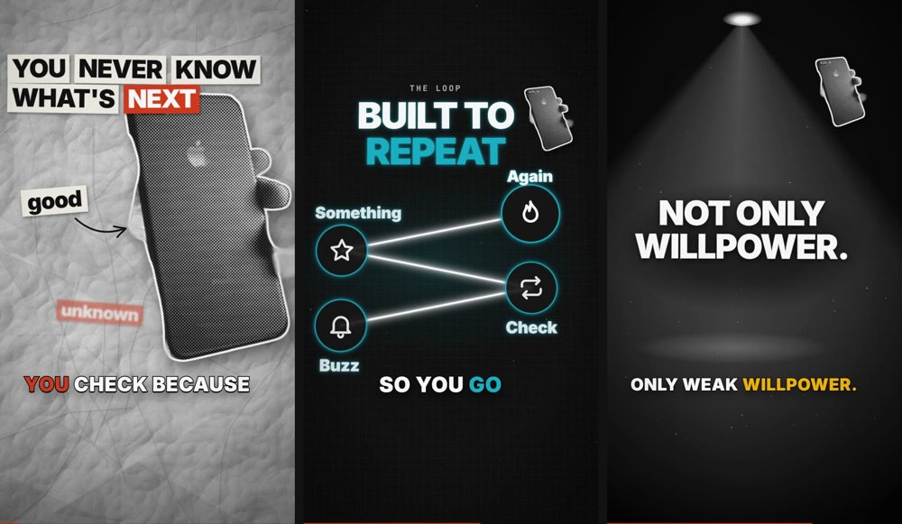
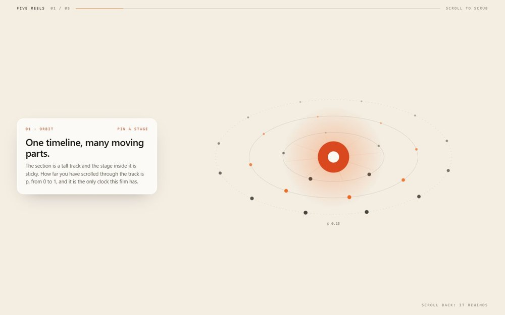

<div align="center">

# ImuTechz Skills

**Agent skills that do the whole job, and check their own work.**

A growing library of skills for Claude Code and other agents that read `SKILL.md`.<br>
Each one is a tested method with its own tools, not just a prompt.

[Skills](#skills) · [Install](#install) · [Add a skill](CONTRIBUTING.md) · [imutechz.in/skills](https://www.imutechz.in/skills)


[](https://github.com/shubham001312/imutechz-skills/actions/workflows/validate.yml)

</div>

## Skills

<table>
<tr>
<td width="34%" valign="top"></td>
<td valign="top">

### [Fish Video Skill](skills/fish-video-skill)

**Make an upload-ready Short, Reel, YouTube or LinkedIn video on any topic.**

It starts with one interview (style, colours, voice, music, API keys), then never interrupts until the final review. It researches trends and sources, cuts out licensed real photos, writes the script, and renders motion graphics with a 3D camera. The mix is balanced for phone speakers, then checked by QA and a self-review pass.

Paper collage · neon diagrams · glow metaphors · screen recordings with focus zoom · word-pop captions

`Python` `Node` `Chromium` `ffmpeg`

[**Read the skill →**](skills/fish-video-skill/SKILL.md)

</td>
</tr>
<tr>
<td width="34%" valign="top"></td>
<td valign="top">

### [Scroll Motion Graphics](skills/scroll-motion-graphics)

**Turn scroll position into a motion-graphics timeline.**

A pinned canvas film that scrubs both ways with the scroll, smooth on phones, with accessibility and performance rules built in. It is the method behind the scroll films on imutechz.in. Try `assets/demo.html`: one file, no dependencies.

Vanilla JS or React · no build step · reduced-motion support

`JavaScript` `Canvas`

[**Read the skill →**](skills/scroll-motion-graphics/SKILL.md)

</td>
</tr>
</table>

## Install

**Claude Code plugin marketplace**

```text
/plugin marketplace add shubham001312/imutechz-skills
/plugin install fish-video-skill@imutechz-skills
/plugin install scroll-motion-graphics@imutechz-skills
```

**Any agent: copy the folder**

```bash
git clone https://github.com/shubham001312/imutechz-skills
cp -r imutechz-skills/skills/<skill-name> ~/.claude/skills/      # Claude Code
cp -r imutechz-skills/skills/<skill-name> .cursor/skills/        # Cursor
```

Keep each folder whole: `SKILL.md` relies on the `references/` and `scripts/` next to it. Some skills need a setup step; each skill's README has it.

Then just ask: *"Make me a 40 second Short about why phones are hard to put down."* The skill takes it from there.

## What a skill here promises

- **It finishes the job.** It covers setup, the work, checks and packaging, not only advice.
- **It checks itself.** Automated checks catch mistakes before you see them, and the skill says what it could not verify.
- **It respects licences.** Third-party assets are logged with their licences. Open-source projects inform the methods, but their code is not copied.
- **It works without paid accounts** wherever possible. API keys are optional, each with a free fallback.
- **It asks first** before anything hard to undo, and never uploads or publishes on its own.

## Repository layout

```text
skills/<skill-name>/      one folder per skill: SKILL.md, README.md, LICENSE, references/, scripts/, assets/
template/                 starting point for a new skill
.claude-plugin/           marketplace manifest
scripts/validate_skills.py   run on every push: frontmatter, licences, catalogue listing, secrets, file sizes
docs/previews/            images for this page
```

Adding a skill takes a folder and a few lines: see [CONTRIBUTING.md](CONTRIBUTING.md).

## License

MIT for the code and documents, unless a skill's folder says otherwise. Bundled third-party material keeps its own licence: see [THIRD_PARTY_NOTICES.md](THIRD_PARTY_NOTICES.md).

Made by [ImuTechz](https://www.imutechz.in).
